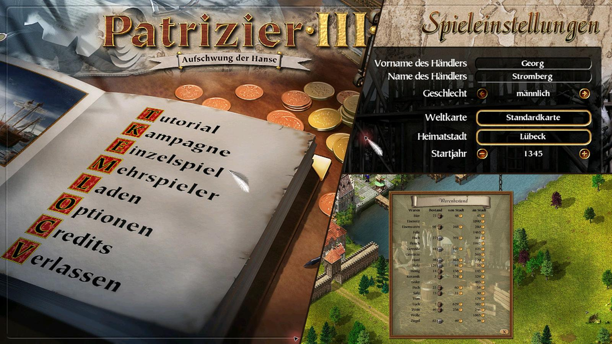

# Patrician III – Deutschmod

Dieser Mod übersetzt Patrician III für GOG und Steam ins Deutsche. Er wird über den P3Modding-Modloader geladen und übersetzt auch ausgewählte Texte der offiziellen Mods.

**Version 0.1.1** · Getestet mit GOG, Steam und P3Modding 0.1.15

## Installation

1. Patrician III von GOG oder Steam installieren.
2. Den [P3Modding-Modloader](https://p3modding.github.io/modloader.html) herunterladen und `p3_modloader.dll` sowie `Patrician3_modloader.exe` ins Spielverzeichnis kopieren.
3. `Patrician3-Deutsch.zip` aus den Releases herunterladen und ins Spielverzeichnis entpacken.
4. Optional die gewünschten DLLs aus [P3Moddings `mods.zip`](https://github.com/P3Modding/p3-lib/releases/tag/0.1.15) in den vorhandenen `mods`-Ordner entpacken.
5. Das Spiel mit `Patrician3_modloader.exe` starten.

## Screenshots



## Wie die Übersetzung funktioniert

Die englische Spiel-EXE wurde mit REA und Ghidra auf Texte, Textzeiger und ihre Verwendung untersucht. Als Referenz für deutsche Formulierungen dienten unter anderem die Originaltexte aus **Patrizier II Gold**. Die Zuordnungen wurden im jeweiligen Zusammenhang abgeglichen; einzelne Texte wurden angepasst oder ergänzt, wenn Patrician III Sätze anders zusammensetzt oder zusätzliche Texte verwendet.

Der Mod ordnet englischen Spieltexten ihre deutschen Fassungen zu. Beim Start prüft er die erwarteten Textadressen und ersetzt die Textzeiger im Speicher. So bleiben unterschiedliche deutsche Formen desselben englischen Wortes an ihren jeweiligen Stellen erhalten.

Ein Texthook übersetzt ausgewählte zusammengesetzte Texte und Beschriftungen anderer Mods. Gilden- und Ereignismeldungen verwenden übersetzte Satzteile wie Artikel, Eigenschaften und Ränge. Ein weiterer Hook berücksichtigt die deutsche Textlänge bei Tooltips weil es sonst natürlich zu einfach wäre. Beide Übersetzungstabellen werden in die DLL eingebettet um gendern/deklinieren nicht zu hardcoden.

Die deutschen Ressourcen im Paket ergänzen die DLL um Dateien wie Missionen, Skripte und Menügrafiken.

## Für Entwickler

Für den Build werden Rust und das Windows-Ziel `i686-pc-windows-msvc` benötigt. Im Projektverzeichnis:

```powershell
rustup target add i686-pc-windows-msvc
cargo build --locked --release --target i686-pc-windows-msvc
```

Die DLL liegt anschließend unter `target/i686-pc-windows-msvc/release/german_localization.dll`. Sie gehört im Spiel nach `mods/german_localization.dll`.

`data/` enthält die Übersetzungstabellen; sie werden beim Build in die DLL eingebettet. `src/` enthält den Mod und seine Tests. Die deutschen Ressourcen liegen unter `assets/`; deren Unterordner entsprechen den Pfaden im Spielverzeichnis. Das Release-Paket enthält diese Dateien und die gebaute DLL.

```text
patrizier3_german/
├── Cargo.toml
├── Cargo.lock
├── README.md
├── .gitignore
├── src/
│   ├── lib.rs
│   ├── patch.rs
│   └── tests.rs
├── data/
│   ├── german_localization.tsv
│   └── render_translations.tsv
├── docs/
│   └── screenshots/
└── assets/
    ├── images/
    ├── maps/
    ├── missions/
    ├── missions_addon/
    └── scripts/
```

Zum Prüfen:

```powershell
cargo fmt --all -- --check
cargo clippy --locked --target i686-pc-windows-msvc --all-targets -- -D warnings
cargo test --locked --target i686-pc-windows-msvc
```

## Lizenz

Der Mod-Code und die eigenen Beiträge zu den Übersetzungstabellen stehen unter der [Apache License 2.0](LICENSE). Spieltexte und die Ressourcen unter `assets/` sind davon nicht umfasst; Rechte Dritter bleiben unberührt.

## Credits und Herkunft

Danke an **P3Modding** für den [Modloader, die Tools und die Dokumentation](https://github.com/P3Modding/p3-lib), auf denen dieser Mod aufbaut.

Besonderer Dank an [**@Trolldemorted**](https://github.com/Trolldemorted) (Benedikt Radtke) für seine großartige Reverse-Engineering-Arbeit. Absoluter Gott!
